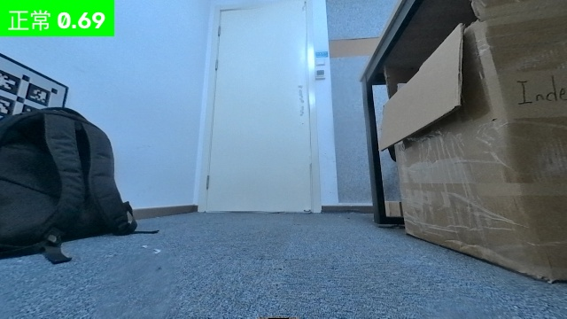
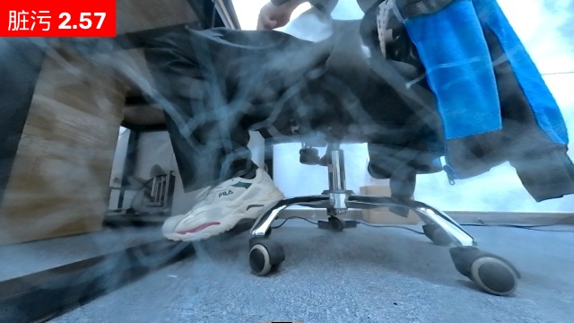

# SimpleNet 镜头脏污检测版本仓库

项目代码按版本快照分目录保存。每个目录都是可独立查看的完整源码状态，不把不同阶段的新增实验脚本混在同一目录。

## 单图推理效果

以下是项目可视化脚本生成的单图示例，左上角显示预测类别和异常分数；仅作推理效果展示，不代表独立测试集指标。

| 正常样例 | 脏污样例 | 脏污样例 |
|---|---|---|
|  |  |  |

| 版本 | 内容 | 代码快照 | 报告预览 |
|---|---|---|---|
| `v0.3.0` | **仅 RGB**：灰度 `240x180` 基线与 ONNX 导出 | [`versions/v0.3.0/`](versions/v0.3.0/) | [查看报告](versions/v0.3.0/report/balanced-sampling-full.png) |
| `v0.3.1` | **三传感器版本**：RGB / stereo / ToF 独立 head、阈值、导出与评估 | [`versions/v0.3.1/`](versions/v0.3.1/) | [开发集](versions/v0.3.1/report/sensor-heads-development.png) · [大样本](versions/v0.3.1/report/sensor-heads-large-test.png) |
| `v0.3.2` | **诊断版**：双目预处理、左右目与正常分布分析，不替换部署模型 | [`versions/v0.3.2/`](versions/v0.3.2/) | [分析](versions/v0.3.2/report/stereo-preprocessing-analysis.png) · [验证](versions/v0.3.2/report/stereo-preprocessing-validation.png) |
| `v0.3.3` | **不采用的实验版**：双目续训对照，AUROC 下降 | [`versions/v0.3.3/`](versions/v0.3.3/) | [查看报告](versions/v0.3.3/report/stereo-finetune-comparison.png) |
| `v0.3.4` | **验证版**：双目固定测试集与阈值验证，保留原始双目 head | [`versions/v0.3.4/`](versions/v0.3.4/) | [查看报告](versions/v0.3.4/report/stereo-validation.png) |
| `v0.3.5` | **候选实验版**：双目 top-k 与 normal-q95 patch 聚合 | [`versions/v0.3.5/`](versions/v0.3.5/) | [查看报告](versions/v0.3.5/report/stereo-aggregation.png) |
| `v0.3.6` | **全传感器候选评估版**：RGB / stereo / ToF 大样本复测 | [`versions/v0.3.6/`](versions/v0.3.6/) | [查看报告](versions/v0.3.6/report/all-sensors-large-test.png) |
| `v0.3.7` | **清理数据 q95 复现版**：训练、校准、导出、评估与逐图查看 | [`versions/v0.3.7/`](versions/v0.3.7/) | [复现说明](versions/v0.3.7/训练测试交接.md) · [保留的旧报告](versions/v0.3.7/report/all-sensors-cleaned-reexport.png) |

每个快照目录含该阶段完整的训练/推理代码、数据适配代码、依赖说明和版本 README。数据集、模型权重和运行结果不属于源码快照。

Git 标签 `v0.3.0` 至 `v0.3.7` 对应各阶段源码；仓库根目录只提供版本索引，方便按目录浏览和下载。
