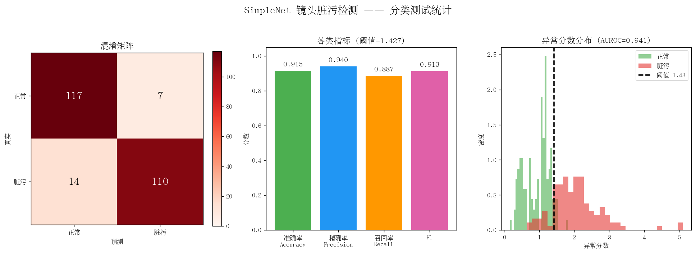

# SimpleNet 镜头脏污检测 — v0.3.0

本目录由 `simplenet-lens-detection1.1/simplenet-lens-detection` 整理而成，是 `v0.3.0` 的完整源码快照。该版本采用灰度图整图缩放到 `240x180`，复制为三通道后输入 WideResNet-50，训练入口为 `run_lens.sh`。

## 版本内容

- `run_lens.sh` / `main.py`：SimpleNet 训练入口。
- `datasets/lens_dirt.py`：镜头脏污数据读取、按录制片段切分和抽帧。
- `export_onnx.py`：导出 ONNX 模型。
- `test_folder.py`：文件夹批量推理。
- `realtime_demo.py`：实时逐帧演示。
- `visualize.py`：推理结果可视化。
- `test_report.py` / `analyze_errors.py`：指标报告和误检分析。
- `测试报告.md`：该阶段的实验说明与指标。

数据集、虚拟环境、checkpoint、ONNX、TensorBoard 日志和批量可视化图片没有上传。训练结果表和报告图体积较小，保留在 `report/` 中。

## 环境

建议 Python 3.8、PyTorch 2.3.1 和 torchvision 0.18.1：

```bash
python3.8 -m venv venv
./venv/bin/pip install torch==2.3.1+cu121 torchvision==0.18.1+cu121 \
  --extra-index-url https://download.pytorch.org/whl/cu121
./venv/bin/pip install -r requirements.txt
```

## 数据结构

```text
data/
  正样本/
    <场景>/<光照>/<data_x>/<时间戳>/cam0/*.jpg
  负样本/
    <场景>/<光照>/<脏污类型>/<程度>/<data_x>/<时间戳>/cam0/*.jpg
```

该版本只使用 RGB `cam0` 图片，并按录制片段划分训练和测试，避免相邻帧同时进入两侧。

## 训练

```bash
DATAPATH=/path/to/data bash run_lens.sh
```

主要设置：输入 `240x180`、灰度复制三通道、每 5 帧抽 1 张、batch size 4、10 个 meta epoch、4 个 GAN epoch。

## ONNX 导出

```bash
./venv/bin/python export_onnx.py \
  --ckpt /path/to/ckpt.pth \
  --out /path/to/model.onnx
```

具体参数以 `export_onnx.py --help` 为准。模型文件不进入源码仓库。

## 报告



训练结果表：[`report/training-results.csv`](report/training-results.csv)。详细分析见 [`测试报告.md`](测试报告.md)。

> `测试报告.md` 中部分早期环境描述与本快照后续的 `240x180` 灰度输入配置可能不完全一致；复现代码时以 `run_lens.sh` 和 `datasets/lens_dirt.py` 为准。
